<p align="center">
  
</p>

<p align="center">
  <a href="https://www.linkedin.com/in/david-felipe-casa%C3%B1as-hernandez-294579225/"></a>
  <a href="mailto:davinzifc@gmail.com"></a>
  
</p>

<p align="center">
  
</p>

---

### `[01] ABOUT_ME`

```bash
$ whoami
david-casanas  // full stack developer · backend specialist · 5+ years

$ cat focus.txt
servers, data and integrations — the part users never see but always feel.
I understand the problem first, build second, and leave systems others can maintain.
```

### `[02] NOW`

- 🟢 **CIAT · CGIAR** — Senior Analyst / Full Stack Developer (2022 → now)
  - Designed the full backend & database architecture of **STAR**, CGIAR's reporting platform
  - Built **Reporting CGIAR**'s backend from scratch (NestJS · JWT · DynamoDB)
  - Leading the vulnerability management program for 4 platforms
- 🔵 **OttoMoto®** (US) — Full Stack Developer, auto-lending fintech (2025)

### `[03] HOW_I_WORK_WITH_AI`

```bash
$ define --what-gets-built        # specs, Gherkin, contracts         [ok]
$ orca run --team claude,codex,cursor   # 3 synchronized "developers" [ok]
$ review --every-step             # no inference, no invention        [ok]
```

> Spec-Driven Development: the AI never improvises — every step is defined first and reviewed by me.

### `[04] STACK`

<p align="left">
  <br>
  <br>
  
</p>

### `[05] METRICS`

<p align="center">
  
  
</p>

<p align="center">
  
</p>

<p align="center">
  
</p>

---

<p align="center"><code>// signal stable · thanks for stopping by_</code></p>
