<p align="center">
  
</p>

<p align="center">
  
</p>

<p align="center">
  <a href="https://www.linkedin.com/in/david-felipe-casa%C3%B1as-hernandez-294579225/"></a>
  <a href="mailto:davinzifc@gmail.com"></a>
</p>

<p align="center">⸻ ✦ ⸻</p>

## Ⅰ · The Creed

I'm **David**, a developer who can't walk away from a hard problem. If something looks impossible, I want to know *why* — and then I want to build the thing anyway.

I love the moment an idea stops being a sketch and starts breathing: a system that holds under pressure, a game that feels good to play, a tool that quietly saves someone hours. Most of what I make starts with a single question: *can I build this?*

<p align="center">⸻ ✦ ⸻</p>

## Ⅱ · The Forge

> Things I craft, for work or simply because I can't stop myself.

| | |
|---|---|
| ⚔️ **Backends that don't fall** | APIs, data models and queues designed to survive real traffic |
| 🕹️ **Games** | a pixel-art game in Swift for iPhone & Mac, and worlds in Unity |
| 🧱 **Mods** | bending Minecraft to my will, one mechanic at a time |
| 🛡️ **Security** | hunting vulnerabilities before anyone else finds them |
| 🧪 **Experiments** | real-time apps, automation, and whatever caught my curiosity this week |

<p align="center">⸻ ✦ ⸻</p>

## Ⅲ · The Ritual

How I build with AI — a coven, not a shortcut.

```text
  I.   SPECIFY    →  every rule written before a single line exists
  II.  SUMMON     →  Orca orchestrates Claude, Codex & Cursor as one synchronized team
  III. JUDGE      →  I review every step; nothing is inferred, nothing is invented
```

<p align="center">⸻ ✦ ⸻</p>

## Ⅳ · The Grimoire

<p align="center">
  <br>
  
</p>

<p align="center">⸻ ✦ ⸻</p>

## Ⅴ · The Chronicles

<p align="center">
  
  
</p>

<p align="center">
  
</p>

<p align="center">⸻ ✦ ⸻</p>

## Ⅵ · Current Quests

- [ ] Finish my pixel-art game in Swift
- [ ] Ship a Minecraft mod worth playing
- [ ] Reach English fluency — one conversation at a time
- [x] Never ship anything I don't understand

<p align="center">
  
</p>

<p align="center"><i>Per aspera ad astra.</i></p>
